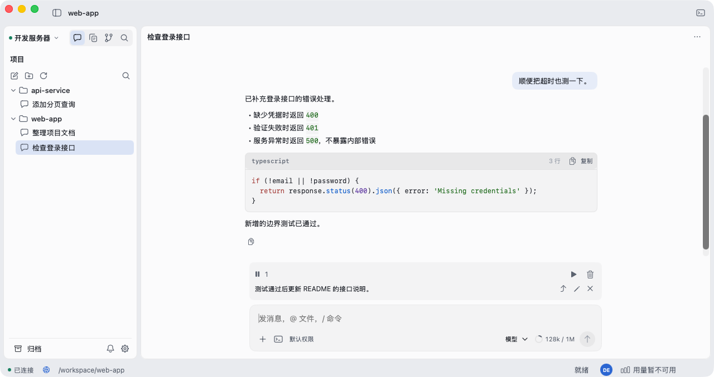
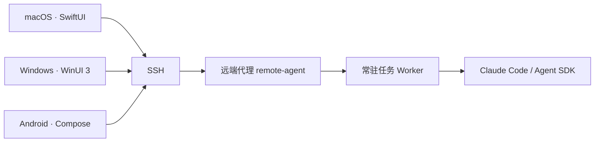

<p align="center"></p>
<h1 align="center">Tether</h1>
<p align="center">在 macOS、Windows 和 Android 上使用服务器里的 Claude Code。</p>
<p align="center">
  <a href="https://github.com/xirichuyi/tether/releases/latest">下载</a> ·
  <a href="docs/getting-started.md">入门指南</a> ·
  <a href="docs/usage.md">使用说明</a> ·
  <a href="docs/server.md">服务器准备</a> ·
  <a href="docs/development.md">开发</a>
</p>

Tether 通过 SSH 连接你的服务器。代码、依赖和 Claude Code 都留在服务器上，客户端负责对话、审批、文件和终端。关掉客户端，服务器上的任务照常运行，回来时接上输出。

不经过任何中转服务，服务器不需要对外开放额外端口。

> 独立开发的非官方客户端，与 Anthropic 没有隶属关系。



## 下载

| 平台 | 安装包 | 要求 |
| --- | --- | --- |
| macOS | `tether-<版本>-macOS-arm64.dmg` | macOS 14+，Apple Silicon |
| Windows | `Claude-Mirror-Setup-x64.exe` | Windows 10 1809+ / 11，x64 |
| Android | `.apk` | Android 8.0+ |

全部在 [Releases](https://github.com/xirichuyi/tether/releases/latest)。macOS 和 Windows 支持应用内更新。

macOS 版还没有经过 Apple 公证，第一次打开会被拦截，处理方法见[入门指南](docs/getting-started.md#macos)。

## 快速开始

1. **准备服务器**：一台能 SSH 登录的 Linux 或 macOS 机器即可。缺 Node.js 或 Claude Code 时，客户端连接后提示一键安装。
2. **添加服务器**：填 `用户名@地址`，用密码、私钥或本机 SSH 配置登录；或者直接粘贴管理员发来的连接码。
3. **登录 Claude**：首次连接按提示在服务器上登录 Claude。
4. **开始对话**：选一个项目目录，开始对话。

多人共用一台服务器时，管理员装好[网页面板](docs/server.md#连接码与网页面板)，给每个人复制一个连接码：

```bash
curl -fsSL https://github.com/xirichuyi/tether/releases/latest/download/install-claude-remote.sh | sudo bash -s -- --panel
```

## 功能

| 功能 | macOS | Windows | Android |
| --- | :-: | :-: | :-: |
| 多服务器、多项目，接着服务器上已有的对话 | ✓ | ✓ | ✓ |
| 流式回复、工具卡片、权限确认、Claude 提问 | ✓ | ✓ | ✓ |
| 排队、插队、停止、暂停 | ✓ | ✓ | ✓ |
| 切换模型和思考强度，上下文用量 | ✓ | ✓ | ✓ |
| 附件上传，断点续传 | ✓ | ✓ | ✓ |
| 远端文件浏览、预览、编辑 | ✓ | ✓ | 浏览、预览 |
| Git 改动和差异 | ✓ | ✓ | ✓ |
| 内置终端 | ✓ | ✓ | ✓ |
| 粘贴连接码添加服务器 | ✓ | ✓ | ✓ |
| 成员管理（root 登录） | ✓ | ✓ | ✓ |
| 断线约 20 秒内发现并自动重连 | ✓ | ✓ | ✓ |
| 回复完成、需要确认时通知 | ✓ | ✓ | ✓ |
| 端口转发 | ✓ | ✓ | |
| 服务器反向连接本机 | ✓ | | |

服务器端：

- **零依赖**：没有 Node.js 时，自动把校验过的 Node.js 装到用户目录。
- **root Full Access**：root 登录可以直接开 Full Access（`IS_SANDBOX=1`）。
- **多人隔离**：每人一个 Linux 账号、自己的 SSH 密钥和 Claude 登录，互相看不到。
- **任务常驻**：客户端断开后任务继续运行，重连后接上输出和待确认请求。

## 文档

| 文档 | 内容 |
| --- | --- |
| [入门指南](docs/getting-started.md) | 第一次使用，从准备服务器到开始对话 |
| [使用说明](docs/usage.md) | 日常操作、SSH 认证、Full Access、额度保护、工具面板 |
| [服务器准备](docs/server.md) | 一键准备、执行账号、多人共用、连接码与网页面板 |
| [高级功能](docs/advanced.md) | 反向连接本机、跨机器同步记忆和会话 |
| [开发指南](docs/development.md) | 从源码构建、架构、测试 |
| [发布流程](docs/release.md) | 打包、签名、稳定版发布与自动更新 |
| [安全说明](SECURITY.md) | 数据存放位置、凭据处理、漏洞报告 |
| 各端说明 | [macOS](macos/README.md) · [Windows](windows/README.md) · [Android](android/README.md) |

## 架构



| 目录 | 内容 |
| --- | --- |
| `macos/` | macOS 客户端（Swift） |
| `windows/` | Windows 客户端（C# / WinUI 3） |
| `android/` | Android 客户端（Kotlin / Jetpack Compose） |
| `src/` | 远端代理、任务 Worker 和网页面板（TypeScript），以及旧版 Electron 客户端 |
| `scripts/` | 服务器安装脚本、构建和端到端测试工具 |
| `test/` | Node 测试 |
| `docs/` | 文档、发布说明、品牌素材 |

## 参与开发

见 [CONTRIBUTING.md](CONTRIBUTING.md)。问题和建议请提交到 [Issues](https://github.com/xirichuyi/tether/issues)，也欢迎在 [Linux DO](https://linux.do/) 交流。

## 许可

[MIT](LICENSE)。第三方依赖遵循各自许可；界面配色、卡片尺寸和动效时长改编自 [winc](https://github.com/DEEIX-AI/Winc)（Apache-2.0），许可证随应用打包。

项目曾名 RemoteCC、Claudock、Claude Mirror。为兼容已有安装，内部模块名、Bundle ID 和服务器上的数据目录仍沿用旧名。
