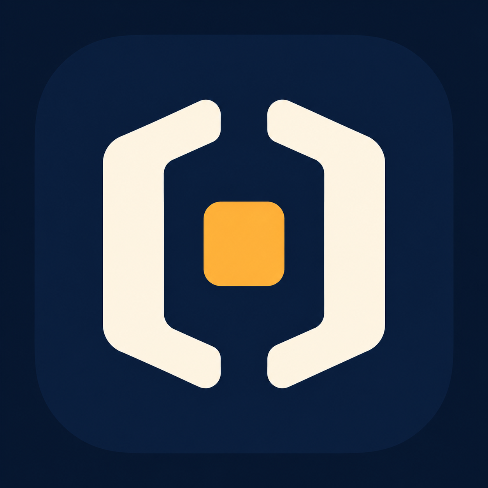
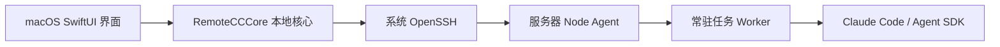

<p align="center"></p>
<h1 align="center">Claudock</h1>
<p align="center">把远端 Claude Code 工作区，接到你的 Mac。</p>

Claudock 是一个通过 SSH 使用远端 Claude Code 的 macOS 原生聊天客户端。代码、依赖、运行环境和 Claude 都留在服务器上，你在 Mac 上管理机器与项目、继续历史对话、审批工具操作、上传附件，以及预览和编辑远端生成的文件。

名字来自 **Claude + Dock**。这是独立开发的客户端，与 Anthropic 没有隶属关系，不是官方 Claude 桌面应用，也不承诺复刻所有终端交互。

## 适合什么场景

- Claude Code 和开发环境安装在 Linux 服务器上，希望在本地以聊天界面工作。
- 同时使用开发机、测试机等多台服务器，需要清楚区分机器和项目。
- 希望关掉客户端后远端任务继续运行，回来时恢复输出和待确认请求。
- Claude 生成了代码、图片、PDF 或视频，希望直接查看或下载到本机。

不需要额外开放公网 Web 服务端口。连接、控制和文件传输通过 SSH 完成；远端 Claude 自身仍需访问模型服务。

## 功能

| 范围 | 当前实现 |
| --- | --- |
| 多主机 | 保存服务器、显示名称、切换机器、按机器区分历史和任务状态；右键机器可重命名 |
| SSH | 系统配置与 Agent、密码、指定私钥文件；用户名与端口；首次连接确认主机指纹 |
| 项目与历史 | 按服务器和工作目录组织会话，先读取索引，按需加载正文和更早消息 |
| 聊天 | 流式回复、Markdown、代码块、思考与工具记录、停止、排队、审批和结构化提问 |
| Claude 能力 | 从远端获取命令与模型；`/` 补全、模型与思考强度选择、会话参数设置 |
| 文件 | 目录树、搜索、附件、拖放上传、截图粘贴、下载、本地打开、文本编辑和冲突检查 |
| 预览 | 文本/代码、图片、PDF；其他格式可下载或交给本机应用 |
| 开发工作流 | Git 变更、隔离 worktree、文件检查点预览与回退、跨机器任务视图 |
| 连接恢复 | SSH ControlMaster 复用、keepalive、退避重连、唤醒检测、远端任务重新订阅 |

命令列表可发现不等于每条命令的后续交互都已适配。新的 Claude 协议、第三方 MCP 或插件的特殊表单需要单独验证。模型可用性、额度和费用由远端账户决定。

## SSH 连接与认证

打开左上角机器菜单，选择「添加机器」。

1. **主机名称**：例如“开发服务器”，仅用于显示；可留空，留空显示地址。
2. **SSH 主机**：IP、域名、SSH config 别名，或 `user@host`。也兼容 `ssh my-server` 的别名输入方式。
3. **用户名**：地址中未包含用户名时可单独填写；留空由系统 SSH 配置决定。
4. **端口**：1–65535，留空使用 SSH 配置或 OpenSSH 默认端口。
5. **认证方式**：按下表选择，再点击「连接机器」。

| 方式 | 用法 |
| --- | --- |
| SSH 配置 / Agent | 复用 `~/.ssh/config`、默认密钥和已加载的 SSH Agent；支持系统配置的跳板机 |
| 密码 | SSH 请求密码时弹出安全输入窗口；支持密码及常规 keyboard-interactive 提示 |
| 私钥文件 | 在文件选择器中选择私钥，传给 OpenSSH 的 `-i`；支持带空格的本地路径；加密私钥按需询问口令 |

首次连接由 OpenSSH 提供指纹，在弹窗中核对后才能信任。已知主机指纹发生变化时连接会失败，应用不会关闭主机校验或自动删除 `known_hosts`。

**密码与口令不写入设置、日志或项目文件，也不存进 Keychain。** 它们通过辅助程序的标准输出直接传给 SSH。连接期间复用已经认证的主连接，不反复询问。密码认证断线或重启客户端后需手动重连并重新输入；后台自动重试不弹出认证窗口。需要无人值守重连时，使用已配置好的密钥/SSH Agent。

当前没有内置私钥生成、密钥上传、SSH config 编辑或复杂企业 SSO 流程。没有启用密码认证的服务器，不能仅靠客户端选项开启密码登录。同一个地址、用户和端口视为同一台机器，显示名称不改变历史归属；更换认证方式前先断开该机器。

## 快速开始

### 环境要求

- 本机：macOS 14+，Xcode 15.3+ 或兼容 Swift 5.10 的工具链，Node.js 和 npm。
- 远端：可用的 SSH 服务、Node.js 18.14+、已安装并配置好认证的 Claude Code。
- 远端用户必须有权限访问对应项目及 Claude 历史。客户端不能绕过服务器权限。

```sh
git clone https://github.com/xirichuyi/claudock.git
cd claudock
npm ci --ignore-scripts
sh macos/scripts/build-app.sh
open macos/dist/RemoteCC.app
```

界面显示名为 Claudock。为兼容旧版安装、存储和构建脚本，目前内部 Swift 模块、bundle ID 和构建输出仍保留 RemoteCC 名称。构建脚本会打包远端代理、SSH 认证辅助程序和应用图标；不要用裸 `swift run` 验收密码弹窗。

构建产物为本地 ad-hoc 签名，尚未提供 Apple 公证的正式发行包。

## 架构



- **界面层**处理输入、导航、审批展示和 macOS 文件选择器。
- **本地核心**管理连接、状态、缓存、历史、文件传输和恢复。
- **远端代理**提供目录、历史、文件和任务接口，通过 SSH 自动部署并按版本复用。
- **任务 Worker**承载远端会话；客户端断开并不主动终止任务。服务器重启或远端进程退出并不能自动保留正在执行的进程。

目录说明：

```text
macos/Sources/RemoteCC/       原生界面及应用状态桥接
macos/Sources/RemoteCCCore/   SSH、协议、会话、历史、文件核心
macos/Helpers/               OpenSSH 认证窗口辅助程序
macos/Tests/                 核心、恢复和远端测试
src/remote-agent.cjs         远端代理
src/task-worker.cjs          Claude SDK 任务进程
src/                        同时保留早期 Electron 客户端
scripts/                    构建与端到端验证脚本
docs/assets/                项目标识
```

这次新增的密码、私钥选择和主机名称属于 **macOS 原生客户端**。旧 Electron 界面尚未同步这些功能。

连接、刷新历史及重连时会批量检查项目目录。已删除目录不再列为可用项目，其对话保留在“目录已移除 · 历史对话”；发送前再次检查。目录重新创建后刷新即可恢复。离线或权限不足不会直接判定为删除。

## 数据和安全边界

聊天和缓存保存在本机；兼容路径为 `~/Library/Application Support/RemoteCC Native`，机器配置保存在应用 UserDefaults。机器配置包含地址、名称、认证方式与私钥路径，不包含密码和私钥内容。

聊天附件上传到远端专用临时目录，按 SHA-256 摘要隔离；重复附件验证远端副本后复用路径，副本丢失或内容变化时重新上传。文件面板的上传仍写入当前浏览目录。临时目录可能被系统清理，不用作长期文件存储；发起聊天会将请求及所附内容交给远端 Claude。权限请求仍需按配置确认，断线不会自动批准。编辑远端文件可能改变服务器项目，检查点回退只覆盖 SDK 跟踪的文件，不等于整个项目快照。

请勿向仓库提交认证文件、私钥、聊天数据库或生产环境配置。

## 测试与兼容范围

```sh
# 核心逻辑和本地代理测试；需要 Node.js 和 npm 依赖
swift test --package-path macos
# 仅运行不访问真实服务器的连接配置测试
swift test --package-path macos --filter SSHConfigurationTests
# Node 单元测试
npm test
```

真实 SSH / 模型测试需显式配置测试主机，见 [macOS 开发与验收记录](macos/README.md)。记录中的测试结果属于对应提交和环境；不能据此认定所有新认证方式、所有服务器或所有 Claude 版本都已通过验收。

后续重点：密码认证的更多服务器兼容性、认证失败后的引导、复杂交互协议适配、完整无障碍验收及正式签名发行。

## 来源与许可

项目从 RemoteCC 演进而来，保留原有提交历史。使用官方 Claude Agent SDK；Markdown 渲染使用 MarkdownUI，其依赖许可随应用打包在 `Resources/ThirdParty`。AgentBox 是交互设计参考之一，本项目没有将其整个客户端直接移植。

项目代码采用 MIT 许可，见 [LICENSE](LICENSE)。第三方依赖遵循各自许可。Claudock 名称和标识不表示获得 Anthropic 官方授权。
