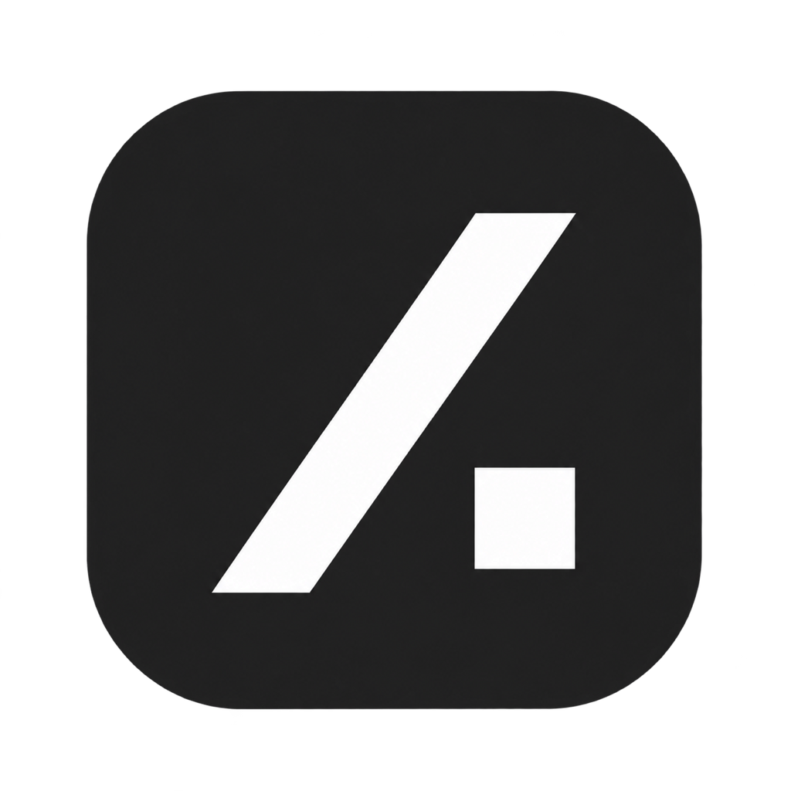
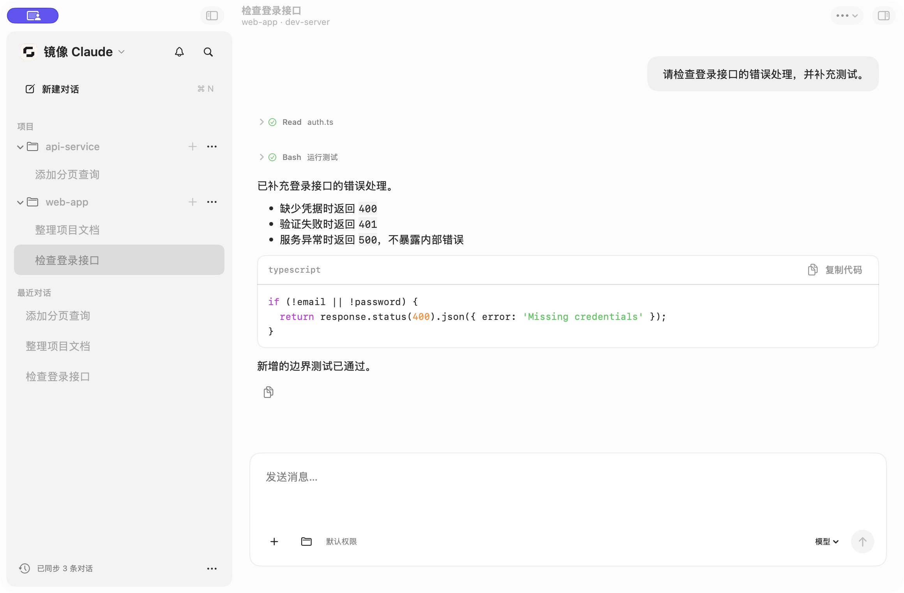
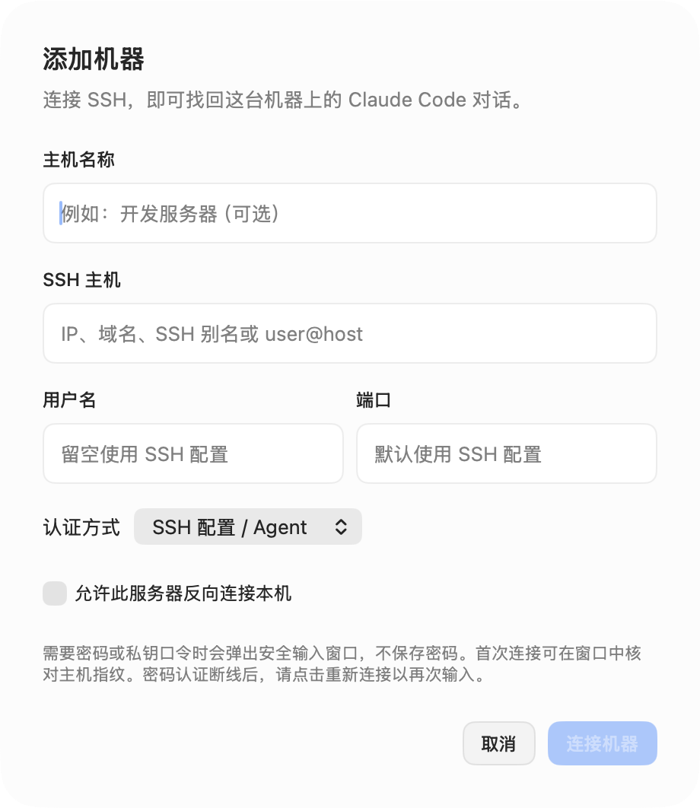
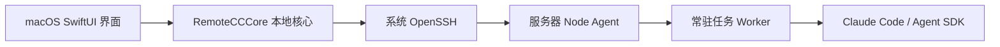

<p align="center"></p>
<h1 align="center">镜像 Claude · Claude Mirror</h1>
<p align="center">把远端 Claude Code 工作区，接到你的桌面。</p>

镜像 Claude 是一个通过 SSH 使用远端 Claude Code 的桌面聊天项目。代码、依赖、运行环境和 Claude 都留在服务器上，你在本地管理机器与项目、继续历史对话、审批工具操作、上传附件，以及预览和编辑远端生成的文件。

**让远端 Claude Code 像本地客户端一样使用。** 这里的“镜像”指把远端工作区呈现在本地，并非模型镜像、容器镜像或 API 转发服务。

这是独立开发的非官方客户端，与 Anthropic 没有隶属关系。项目目标是尽量复用 Claude Code 的原生能力；当前适配范围和限制见下文。

## 下载与平台

**[下载最新版 · GitHub Releases](https://github.com/xirichuyi/claude-mirror/releases/latest)** · [全部版本](https://github.com/xirichuyi/claude-mirror/releases)

| 客户端 / 环境 | 当前状态 |
| --- | --- |
| macOS 原生客户端 | SwiftUI / AppKit；macOS 14+，本次提供 Apple Silicon（arm64）DMG |
| Intel Mac | 可尝试使用对应 Mac 从源码构建；本次不提供已验证的 Intel 安装包 |
| Electron 客户端 | 仓库保留跨平台实现，可从源码启动；与原生版功能尚未完全一致 |
| Windows 原生客户端（预览） | C# / WinUI 3，Windows 10 1809+ / Windows 11 x64；[构建与功能范围](windows/README.md)，[下载 CI 工件](https://github.com/xirichuyi/claude-mirror/actions/workflows/windows.yml) |
| Linux 本地客户端 | 可尝试 Electron 源码版本；未完成发行验收 |
| 远端服务器 | 通过 SSH 访问；主要验证 Linux。安装脚本支持 Linux、macOS、WSL 的 Linux 环境 |

项目不限定本地操作系统；**当前可以直接下载的正式构建产物是 macOS arm64 版**，不代表其他平台已经完成打包与测试。

### 安装 DMG

1. 从发布页下载 `claude-mirror-0.20.0-macOS-arm64.dmg`。
2. 打开 DMG，将 **claude-mirror.app** 拖入 **Applications**。
3. 从应用程序启动「镜像 Claude」，添加 SSH 主机。

本机使用 DMG 无需安装 Node.js、Swift 或 Xcode；远端仍需要 Node.js 和 Claude Code。发布页附 SHA-256 校验文件。

**检查更新**：应用启动后会查询本仓库的 GitHub Releases，之后每天最多查一次；发现新版本时会弹窗，可选择下载 DMG、查看更新内容或跳过此版本。也可以从菜单“镜像 Claude → 检查更新…”手动检查。应用只负责提醒，不会自动下载或替换自身（当前构建未经 Apple 公证）。升级时用新版替换“应用程序”中的旧版即可，聊天记录和机器配置会保留。

当前构建为 ad-hoc 签名，尚未通过 Apple Developer ID 签名和 Apple 公证。macOS 可能阻止首次启动；核对下载来源后，可在「系统设置 → 隐私与安全性」中允许本次打开。不要关闭全局 Gatekeeper。

## 界面预览

以下截图来自实际原生客户端的隔离文档示例，使用虚构主机与对话，不包含个人服务器信息。





## 适合什么场景

- Claude Code 和开发环境安装在 Linux 服务器上，希望在本地以聊天界面工作。
- 同时使用开发机、测试机等多台服务器，需要清楚区分机器和项目。
- 希望关掉客户端后远端任务继续运行，回来时恢复输出和待确认请求。
- Claude 生成了代码、图片、PDF 或视频，希望直接查看或下载到本机。

不需要额外开放公网 Web 服务端口。连接、控制和文件传输通过 SSH 完成；远端 Claude 自身仍需访问模型服务。

## 功能

| 范围 | 当前实现 |
| --- | --- |
| 多主机 | 保存服务器、显示名称、切换机器、按机器区分历史和任务状态；右键机器可重命名 |
| SSH | 系统配置与 Agent、密码、指定私钥文件；用户名与端口；首次连接确认主机指纹 |
| 项目与历史 | 按服务器和工作目录组织会话，先读取索引，按需加载正文和更早消息 |
| 聊天 | 流式回复、Markdown、代码块、思考与工具记录、停止、排队、审批和结构化提问 |
| Claude 能力 | 从远端获取命令与模型；`/` 补全、模型与思考强度选择、会话参数设置 |
| 文件 | 目录树、搜索、附件、拖放上传、截图粘贴、下载、本地打开、文本编辑和冲突检查 |
| 预览 | 文本/代码、图片、PDF；其他格式可下载或交给本机应用 |
| 开发工作流 | Git 变更、隔离 worktree、文件检查点预览与回退、跨机器任务视图 |
| 连接恢复 | SSH ControlMaster 复用、keepalive、退避重连、唤醒检测、远端任务重新订阅 |

命令列表可发现不等于每条命令的后续交互都已适配。新的 Claude 协议、第三方 MCP 或插件的特殊表单需要单独验证。模型可用性、额度和费用由远端账户决定。

## SSH 连接与认证

打开左上角机器菜单，选择「添加机器」。

1. **主机名称**：例如“开发服务器”，仅用于显示；可留空，留空显示地址。
2. **SSH 主机**：IP、域名、SSH config 别名，或 `user@host`。也兼容 `ssh my-server` 的别名输入方式。
3. **用户名**：地址中未包含用户名时可单独填写；留空由系统 SSH 配置决定。
4. **端口**：1–65535，留空使用 SSH 配置或 OpenSSH 默认端口。
5. **认证方式**：按下表选择，再点击「连接机器」。

| 方式 | 用法 |
| --- | --- |
| SSH 配置 / Agent | 复用 `~/.ssh/config`、默认密钥和已加载的 SSH Agent；支持系统配置的跳板机 |
| 密码 | SSH 请求密码时弹出安全输入窗口；支持密码及常规 keyboard-interactive 提示 |
| 私钥文件 | 在文件选择器中选择私钥，传给 OpenSSH 的 `-i`；支持带空格的本地路径；加密私钥按需询问口令 |

首次连接由 OpenSSH 提供指纹，在弹窗中核对后才能信任。已知主机指纹发生变化时连接会失败，应用不会关闭主机校验或自动删除 `known_hosts`。

**密码与口令不写入设置、日志或项目文件，也不存进 Keychain。** 它们通过辅助程序的标准输出直接传给 SSH。连接期间复用已经认证的主连接，不反复询问。密码认证断线或重启客户端后需手动重连并重新输入；后台自动重试不弹出认证窗口。需要无人值守重连时，使用已配置好的密钥/SSH Agent。

当前没有内置私钥生成、密钥上传、SSH config 编辑或复杂企业 SSO 流程。没有启用密码认证的服务器，不能仅靠客户端选项开启密码登录。同一个地址、用户和端口视为同一台机器，显示名称不改变历史归属；更换认证方式前先断开该机器。

## 服务器反向连接本机

在机器菜单中右键服务器，勾选“允许此服务器反向连接本机”，该服务器就能通过本应用已有的 SSH 连接登录这台 Mac。这项功能不用另开隧道，也不需要公网 IP 或端口映射；默认关闭，需要每台服务器单独开启，目前只有 macOS 原生客户端支持。

开启后，应用在每次连接或重连时会做以下几件事：

1. 在服务器的 `~/.claude-mirror/reverse/`（权限 700）里绑定一个仅本用户可访问的 Unix socket，转发到本机的 22 端口。这里不监听 TCP 端口；断线留下的旧 socket 会先删除再重新绑定。
2. 在服务器上生成一把专用密钥，加入本机的 `~/.ssh/authorized_keys`，并加上 `from="127.0.0.1,::1"` 限制：这把密钥只能经由该通道使用，其他已有的行保持原样。
3. 把本机的 ed25519 主机公钥写到服务器上，服务器首次连接时不用手动核对指纹。
4. 生成一份 ssh_config 并开启连接复用。菜单中的“复制反向连接命令”会得到 `ssh -F ~/.claude-mirror/reverse/<名称>.config <名称>`；`scp`、`rsync -e` 加上同样的 `-F` 参数即可使用。
5. 连接期间阻止 Mac 因闲置自动休眠，合盖或手动睡眠不受影响。

取消勾选后，应用会立即从 `authorized_keys` 删除这一行，即使当前离线也会删除；如果服务器在线，还会关闭它已打开的会话并删除 socket。

需要满足的条件：本机已开启“系统设置 → 通用 → 共享 → 远程登录”；服务器安装了 `socat`；应用正在运行并已连接该服务器。退出应用、Mac 进入睡眠或网络断开时，反向连接也会中断。

**开启期间，服务器上任何能读取该专用密钥的程序或用户，都能以你的身份登录这台 Mac。** 只对你信任的服务器开启，不用时关闭。

反向流量和聊天流量共用同一条 SSH 连接。实测在约 300ms 延迟的跨境线路上，反向连接的速度与单独开隧道相当；但通过它传输大文件时，应用里的操作会变慢 50%–100%，传完即恢复。

## 从源码运行

### 环境要求

- 本机：macOS 14+，Xcode 15.3+ 或兼容 Swift 5.10 的工具链，Node.js 和 npm。
- 远端：可用的 SSH 服务、Node.js 18.14+、已安装并配置好认证的 Claude Code。
- 远端用户必须有权限访问对应项目及 Claude 历史。客户端不能绕过服务器权限。

```sh
git clone https://github.com/xirichuyi/claude-mirror.git
cd claude-mirror
npm ci --ignore-scripts
sh macos/scripts/build-app.sh
open macos/dist/claude-mirror.app
```

源码构建后的界面显示名为“镜像 Claude”。为兼容旧版安装、存储和构建脚本，目前内部 Swift 模块、bundle ID 和构建输出仍保留 RemoteCC 名称。构建脚本会打包远端代理、SSH 认证辅助程序和应用图标；不要用裸 `swift run` 验收密码弹窗。

### Electron 客户端

```sh
git clone https://github.com/xirichuyi/claude-mirror.git
cd claude-mirror
npm ci
npm start
```

此入口启动跨平台 Electron 界面，不会启动 SwiftUI 客户端。需要本机 Node.js、npm 和系统 OpenSSH；Linux 还需要图形桌面及 Electron 运行依赖。Windows/Linux 尚需平台验证，旧界面也不包含所有原生版新功能。

### 自行打包 DMG

```sh
sh macos/scripts/build-dmg.sh
```

脚本在当前 Mac 架构上构建、验证签名并生成压缩磁盘映像与 SHA-256 文件，产物位于 `macos/dist/`。

### GitHub Actions 构建与发布

- **CI**（`.github/workflows/ci.yml`）：推送到 main 或提交 PR 时，在 Linux 上运行 Node 测试，在 macOS 26（Apple Silicon，Xcode 26）上运行 Swift 测试并打包 DMG。DMG 作为构建产物保留 14 天，可在对应运行记录中下载。
- **Release**（`.github/workflows/release.yml`）：推送 `v*` 标签时，先核对标签与 `Info.plist` 中的版本号一致，再测试、打包，并把 DMG、校验文件和远端脚本上传到同名 Release。Release 不存在时自动创建，说明取自 `docs/releases/<标签>.md`。也可以在 Actions 页面手动运行，为已有标签重新构建并上传。

发布新版本：

```sh
# 1. 修改 macos/Resources/Info.plist 中的 CFBundleShortVersionString 和 CFBundleVersion
# 2. 编写 docs/releases/v0.20.0.md
git commit -am "Release v0.20.0" && git push origin main
git tag -a v0.20.0 -m "claude-mirror v0.20.0" && git push origin v0.20.0
```

CI 构建同样只做 ad-hoc 签名，不经过 Apple 公证。

## 远端一键准备

在本地仓库目录运行，脚本先通过 SSH 连接远端，再检测和安装 Claude：

```sh
sh scripts/setup-remote.sh my-server
# 或指定端口、私钥和用户
sh scripts/setup-remote.sh -p 2222 -i ~/.ssh/id_ed25519 user@example.com
```

- 使用系统 OpenSSH，支持 SSH config 别名、密码和密钥；保留主机指纹检查。
- **已有 Claude：** 只验证能否运行，不覆盖、不升级、不改认证配置。
- **没有 Claude：** 下载 [Claude 官方安装器](https://github.com/anthropics/claude-code#installation)并安装 stable 版本，由官方安装器选择平台和架构。
- 安装后检查远端 Node.js ≥18.14；不满足时提示并返回非零状态，不擅自修改系统包。
- 不会自动登录、索取 API Key，也不会把本机 Claude 凭据传到服务器。

如需登录，请在服务器交互式终端运行 `claude auth login`；新安装通常位于 `~/.local/bin/claude`。完成后回到客户端连接同一主机。安装器要求远端能访问官方站点；发行地区、网络或系统依赖问题会按实际错误显示。

**该步骤由你运行脚本触发，不是每次客户端连接都静默安装。** DMG 内也附带这两个脚本；一起复制到本地后即可使用。

## 复制给 Agent 的使用指引

把下面整段交给你的编程 Agent，并补充本机平台及 SSH 主机；不要在提示词中填密码或 API Key。

```text
请帮我部署和使用「镜像 Claude / Claude Mirror」。
项目：https://github.com/xirichuyi/claude-mirror
我的本机系统：[填写系统与 CPU 架构]
目标 SSH 主机：[填写 SSH config 别名或 user@host]
远端项目目录：[填写绝对路径]

请先阅读仓库 README，再按实际平台操作：
1. 确认本机平台与架构。Apple Silicon macOS 14+ 优先使用 GitHub Releases
   的 DMG；Windows x64 查看 windows/README.md 的原生预览版和 CI ZIP；
   Linux 检查 Electron 源码入口，不要假设存在正式安装包。
2. 验证 SSH 连通性和主机身份。沿用我的 SSH 配置，不关闭主机指纹验证。
3. 检查远端 Node.js 和 Claude Code。若 Claude 缺失，运行仓库的
   scripts/setup-remote.sh 连接目标主机并安装；保留已有安装及认证配置。
4. 需要账户登录时让我在远端交互式终端完成，不读取或复制 auth.json、
   API Key、私钥内容，也不要把凭据写进仓库。
5. 启动客户端，添加有名称的主机，选择远端项目并加载历史。
6. 用无敏感内容的临时样例确认：聊天附件进入远端临时目录；同名同内容
   复用路径，同名不同内容产生新路径；文件面板上传则写入当前目录。
7. 验证文件预览、模型选择和连接恢复，说明已验证内容及平台限制。
   不删除我的项目文件，不运行与任务无关的命令，不自动发送真实工作内容。
```

## 跨机器同步记忆和会话

`scripts/agent-sync.cjs` 让 VPS 和本地的 Agent 共用记忆，并能接手对方的会话。账号只在 VPS 上登录，同步范围不包含凭据。机器之间只需要能用 SSH 互连：本地直连 VPS 公网，或使用 WireGuard、Tailscale 等内网地址都可以。同步不经过第三方服务，也不转发模型流量。

| 内容 | 同步方式 |
| --- | --- |
| Claude 项目记忆 | 双向同步；同一文件冲突时两个版本都保留（`*.conflict-*`），`MEMORY.md` 按行合并 |
| 会话交接记录 | 每个会话生成脱敏 Markdown，只含对话和工具摘要，不含工具输出和思考内容 |
| 原始会话 | 默认本地的上传到 VPS；在本地 `config.json` 设 `"uploadRaw": false` 后留在本地，VPS 运行 `resume` 时通过 `--peer` 配置的 SSH 连接读取 |
| 凭据、设置、历史 | 从不读取或同步 |

Claude Code 的 `SessionStart`、`Stop`、`SessionEnd` hook 和 Codex 的 `notify` 触发同步，每 5 分钟的定时任务兜底。其他 Agent 可以在任务结束时调用 `agent-sync sync --quiet` 接入。需要 macOS、Linux 或 WSL，以及 Node.js、git、rsync。

```sh
# VPS
node scripts/agent-sync.cjs install --role hub --host vps

# 本地：确认能免密 ssh 到 VPS 后运行
node scripts/agent-sync.cjs install --role spoke --host laptop --hub root@<VPS 地址> --hub-host vps

# VPS：可选，任务完成后立刻通知本地。需要 VPS 能 SSH 到本地，
# 例如开启下文的“服务器反向连接本机”，再在 VPS 的 ~/.ssh/config 中为本机配置别名
~/.agent-sync/bin/agent-sync install --peer <本机的 SSH 别名>
```

不同机器上路径不同的项目，如果 `origin` 相同会自动对应；否则在两边各运行一次 `agent-sync link <共享名> <路径>`。

```sh
agent-sync sessions --project   # 查看当前项目在各机器上的会话
agent-sync show <会话ID>        # 读取交接记录
agent-sync resume <会话ID>      # 把原始会话下载到本机，并给出恢复命令
agent-sync doctor               # 检查 hub、对端连通性和记忆冲突
```

同一个会话不要同时在两台机器上继续，否则会分叉成两条历史。原始会话没有脱敏，只保存在你自己的机器上。

## 日常使用

1. **连接服务器**：添加一个有名称的 SSH 主机，连接后自动发现该用户的 Claude 历史。
2. **选择项目**：在左侧展开项目继续对话，或选择远端目录开始新对话。正文按需加载，不一次下载全部聊天。
3. **发送任务**：输入消息；输入 `/` 搜索远端命令，使用模型菜单切换远端提供的模型。回复中可停止，也可输入下一条消息加入队列。
4. **附加文件**：把本机文件拖入输入框，或点击 `＋`。上传完成后显示附件，发送时将远端绝对路径交给 Claude。
5. **管理文件**：打开文件面板浏览服务器；每行 `…` 菜单提供重命名、下载、删除等操作。删除需确认，直接作用于服务器。
6. **查看产物**：点击聊天中的文件链接预览；可编辑文本、下载副本或使用本机软件打开。

### 附件与目录上传有什么区别？

| 操作 | 存放位置 | 重复文件行为 |
| --- | --- | --- |
| 输入框拖放、`＋`、粘贴截图 | 远端当前用户专用临时目录 | 同名同内容复用已校验的路径，不再传输文件内容 |
| 同名文件修改后再次作为附件上传 | 新的内容摘要目录 | 保留旧版，新消息引用新版路径 |
| 文件面板的上传按钮 | 当前浏览的远端目录 | 不覆盖已有同名文件，冲突时提示 |

附件通过 SHA-256 校验内容，文件名保留。远端临时副本被清理或修改后，再次附加会重新上传。临时目录不是长期存储；需要保存的产物请下载或放入项目目录。已经上传的旧项目文件不会因升级自动移动或删除。

### 断开连接后会怎样？

远端任务由独立 Worker 执行，关闭窗口或断开 SSH 不会主动停止它。重新连接后恢复订阅输出与待确认请求。服务器重启、远端进程被杀死或模型服务失败不属于可保证继续执行的情况。需要审批的任务仍会等待确认。

新版本的 Worker 在没有回复、授权请求或后台任务时，连续空闲 15 分钟会释放 Claude 与 Worker 进程，保留历史和远端会话 ID，下次发送时恢复会话。旧版本已经启动的 Worker 需要正常关闭后重新建立，才能使用新的回收逻辑。

## 架构



- **界面层**处理输入、导航、审批展示和 macOS 文件选择器。
- **本地核心**管理连接、状态、缓存、历史、文件传输和恢复。
- **远端代理**提供目录、历史、文件和任务接口，通过 SSH 自动部署并按版本复用。
- **任务 Worker**承载远端会话；客户端断开并不主动终止任务。服务器重启或远端进程退出并不能自动保留正在执行的进程。

目录说明：

```text
macos/Sources/RemoteCC/       原生界面及应用状态桥接
macos/Sources/RemoteCCCore/   SSH、协议、会话、历史、文件核心
macos/Helpers/               OpenSSH 认证窗口辅助程序
macos/Tests/                 核心、恢复和远端测试
src/remote-agent.cjs         远端代理
src/task-worker.cjs          Claude SDK 任务进程
src/                        同时保留早期 Electron 客户端
scripts/                    构建与端到端验证脚本
docs/assets/                项目标识
```

密码、私钥选择和主机名称已在 macOS 与 Windows 原生客户端接入。Windows 目前为基础功能预览版；旧 Electron 界面尚未同步这些功能。

连接、刷新历史及重连时会批量检查项目目录。已删除目录不再列为可用项目，其对话保留在“目录已移除 · 历史对话”；发送前再次检查。目录重新创建后刷新即可恢复。离线或权限不足不会直接判定为删除。

## 数据和安全边界

聊天和缓存保存在本机；兼容路径为 `~/Library/Application Support/RemoteCC Native`，机器配置保存在应用 UserDefaults。机器配置包含地址、名称、认证方式与私钥路径，不包含密码和私钥内容。

聊天附件上传到远端专用临时目录，按 SHA-256 摘要隔离；重复附件验证远端副本后复用路径，副本丢失或内容变化时重新上传。文件面板的上传仍写入当前浏览目录。临时目录可能被系统清理，不用作长期文件存储；发起聊天会将请求及所附内容交给远端 Claude。权限请求仍需按配置确认，断线不会自动批准。编辑远端文件可能改变服务器项目，检查点回退只覆盖 SDK 跟踪的文件，不等于整个项目快照。

请勿向仓库提交认证文件、私钥、聊天数据库或生产环境配置。

## 测试与兼容范围

```sh
# 核心逻辑和本地代理测试；需要 Node.js 和 npm 依赖
swift test --package-path macos
# 仅运行不访问真实服务器的连接配置测试
swift test --package-path macos --filter SSHConfigurationTests
# Node 单元测试
npm test
```

真实 SSH / 模型测试需显式配置测试主机，见 [macOS 开发与验收记录](macos/README.md)。记录中的测试结果属于对应提交和环境；不能据此认定所有新认证方式、所有服务器或所有 Claude 版本都已通过验收。

后续重点：密码认证的更多服务器兼容性、认证失败后的引导、复杂交互协议适配、完整无障碍验收及正式签名发行。

## 来源与许可

项目曾名 RemoteCC、Claudock，现统一为镜像 Claude（Claude Mirror），保留原有提交历史与用户数据兼容路径。使用官方 Claude Agent SDK；Markdown 渲染使用 MarkdownUI，其依赖许可随应用打包在 `Resources/ThirdParty`。AgentBox 是交互设计参考之一，本项目没有将其整个客户端直接移植。

项目代码采用 MIT 许可，见 [LICENSE](LICENSE)。第三方依赖遵循各自许可。镜像 Claude 名称和标识不表示获得 Anthropic 官方授权。

## 社区

欢迎在 [Linux DO 社区](https://linux.do/)交流使用体验。问题反馈与功能建议请提交到 [GitHub Issues](https://github.com/xirichuyi/claude-mirror/issues)。
