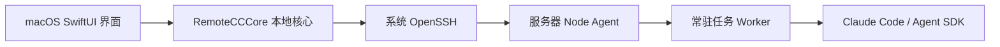

# 开发指南

从源码构建、测试与代码结构。各端细节见 [macOS](../macos/README.md)、[Windows](../windows/README.md)、[Android](../android/README.md)。

## macOS 客户端

- 本机：macOS 14+，Xcode 15.3+ 或兼容 Swift 5.10 的工具链，Node.js 和 npm。
- 远端：可用的 SSH 服务、已安装并配置好认证的 Claude Code。没有 Node.js 18.14+ 时连接会自动装到用户目录。
- 远端用户必须有权限访问对应项目及 Claude 历史。客户端不能绕过服务器权限。

```sh
git clone https://github.com/xirichuyi/tether.git
cd tether
npm ci --ignore-scripts
sh macos/scripts/build-app.sh
open macos/dist/Tether.app
```

源码构建后的界面显示名为 Tether。为兼容旧版安装、存储和构建脚本，内部 Swift 模块、bundle ID 和构建输出仍保留 RemoteCC 名称。构建脚本会打包远端代理、SSH 认证辅助程序和应用图标；不要用裸 `swift run` 验收密码弹窗。

### 自行打包 DMG

```sh
sh macos/scripts/build-dmg.sh
```

脚本在当前 Mac 架构上构建、验证签名并生成压缩磁盘映像与 SHA-256 文件，产物位于 `macos/dist/`。

## Electron 客户端（旧版）

```sh
git clone https://github.com/xirichuyi/tether.git
cd tether
npm ci
npm start
```

此入口启动跨平台 Electron 界面，不会启动 SwiftUI 客户端。需要本机 Node.js、npm 和系统 OpenSSH；Linux 还需要图形桌面及 Electron 运行依赖。Windows/Linux 尚需平台验证，旧界面也不包含所有原生版新功能。

## 架构



- **界面层**处理输入、导航、审批展示和 macOS 文件选择器。
- **本地核心**管理连接、状态、缓存、历史、文件传输和恢复。
- **远端代理**提供目录、历史、文件和任务接口，通过 SSH 自动部署并按版本复用。
- **任务 Worker**承载远端会话；客户端断开并不主动终止任务。服务器重启或远端进程退出并不能自动保留正在执行的进程。

目录说明：

```text
macos/Sources/RemoteCC/       原生界面及应用状态桥接
macos/Sources/RemoteCCCore/   SSH、协议、会话、历史、文件核心
macos/Helpers/               OpenSSH 认证窗口辅助程序
macos/Tests/                 核心、恢复和远端测试
src/remote-agent.cts         远端代理
src/task-worker.cts          Claude SDK 任务进程
src/                        TypeScript 源码，同时保留早期 Electron 客户端
build/src/                  编译后的运行文件与界面资源，不提交到 Git
scripts/                    TypeScript 构建、命令行工具与端到端验证脚本
test/                       TypeScript 测试
build/scripts/              编译后的工具入口
build/test/                 编译后的测试
docs/assets/                项目标识
```

密码、私钥选择和主机名称已在 macOS 与 Windows 原生客户端接入。Windows 目前为基础功能预览版；旧 Electron 界面尚未同步这些功能。

连接、刷新历史及重连时会批量检查项目目录。已删除目录不再列为可用项目，其对话保留在“目录已移除 · 历史对话”；发送前再次检查。目录重新创建后刷新即可恢复。离线或权限不足不会直接判定为删除。

## TypeScript 开发

全部自有 JavaScript（应用、测试、构建、命令行工具及原生资源准备脚本）已迁移到 TypeScript。Node/Electron 源码和工具使用 `.cts`（TypeScript 的 CommonJS 扩展名），浏览器经典脚本使用 `.ts`。`npm run build` 将两者分别编译为 `build/src/*.cjs` 和 `build/src/*.js`，并将工具和测试编译到 `build/scripts`、`build/test`，原生资源准备程序编译到 `build/macos/scripts`。请编辑对应源码目录中的 `.ts`/`.cts`，不要编辑 `build` 中的产物。远端机器接收普通 JavaScript，不需要安装 TypeScript。

```sh
npm ci --ignore-scripts
npm run typecheck  # 检查源码与编译期接口测试，不生成文件
npm run build      # 编译代码并准备运行资源
npm test           # 自动进行类型检查、编译，再运行 Node 测试
```

`npm start` 和 `npm run pack` 会自动编译。`npm run prepare-server -- <输出目录>` 会先编译，再由 `macos/scripts/prepare-server.cts` 的产物计算 Agent/Worker 摘要并打包，macOS/Windows 共用此入口。直接运行 `node build/scripts/*smoke.cjs` 或 `node --test build/test/*.test.cjs` 前，请先执行 `npm run build`。构建脚本本身由 `tsconfig.bootstrap.json` 先编译，然后执行，因此干净检出也能构建，不依赖预先生成的 JavaScript 或 Node 的 TypeScript 直接执行功能。

会话、偏好、文件传输和 RPC 的共享类型在 `src/contracts.d.ts`，preload 导出的接口类型供浏览器复用。所有源码、测试和工具都纳入类型检查；类型检查错误会阻止构建。测试会检查仓库中是否重新出现自有 JavaScript 源文件。当前迁移保留了动态 SDK/JSON 数据的部分 `any`，并暂时关闭隐式 any、空值和 catch 未知类型的严格检查；这是可继续收紧的迁移基线，不代表所有数据已经完整建模。外部输入仍由现有运行时校验负责。

## 测试

```sh
# 核心逻辑和本地代理测试；需要 Node.js 和 npm 依赖
swift test --package-path macos
# 仅运行不访问真实服务器的连接配置测试
swift test --package-path macos --filter SSHConfigurationTests
# Node 单元测试
npm test
```

真实 SSH / 模型测试需显式配置测试主机，见 [macOS 开发与验收记录](../macos/README.md)。记录中的测试结果属于对应提交和环境；不能据此认定所有新认证方式、所有服务器或所有 Claude 版本都已通过验收。

后续重点：密码认证的更多服务器兼容性、认证失败后的引导、复杂交互协议适配、完整无障碍验收及正式签名发行。

## 相关文档

- [发布流程](release.md)
- [macOS 界面代码规范](macos-code-style.md)
- [远端代理协议](agent-wire.md)
- [功能对照](feature-parity.md)
- [竞品调研](research/claude-desktop.md)
